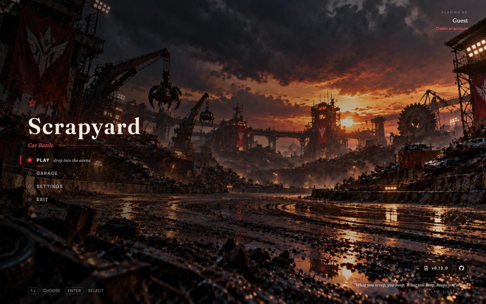
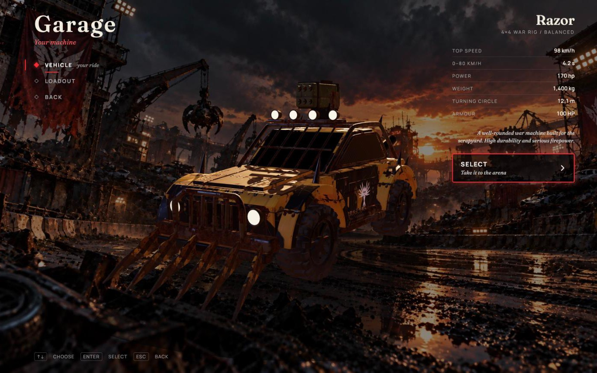
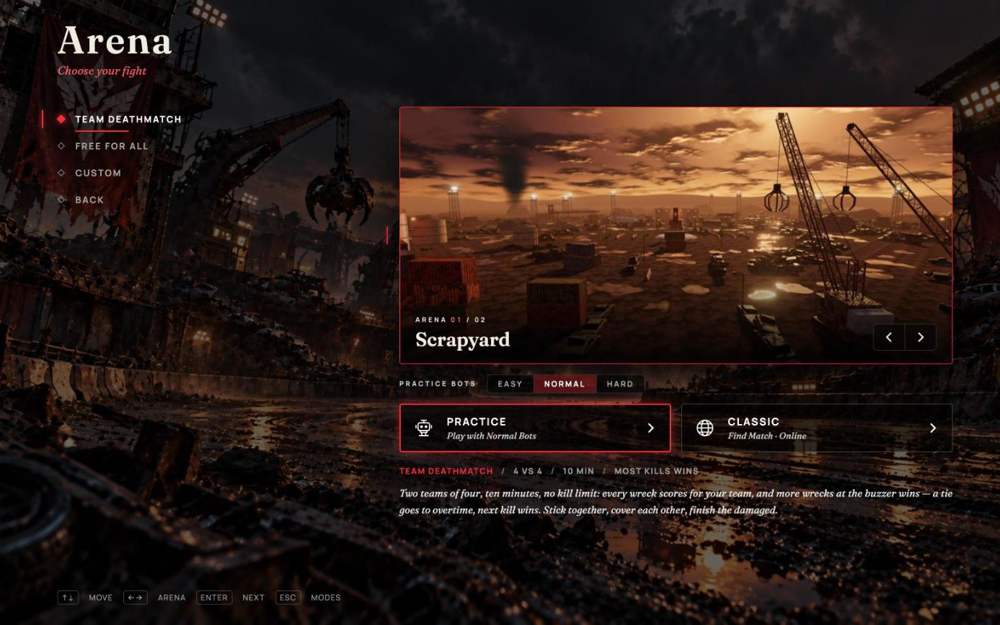
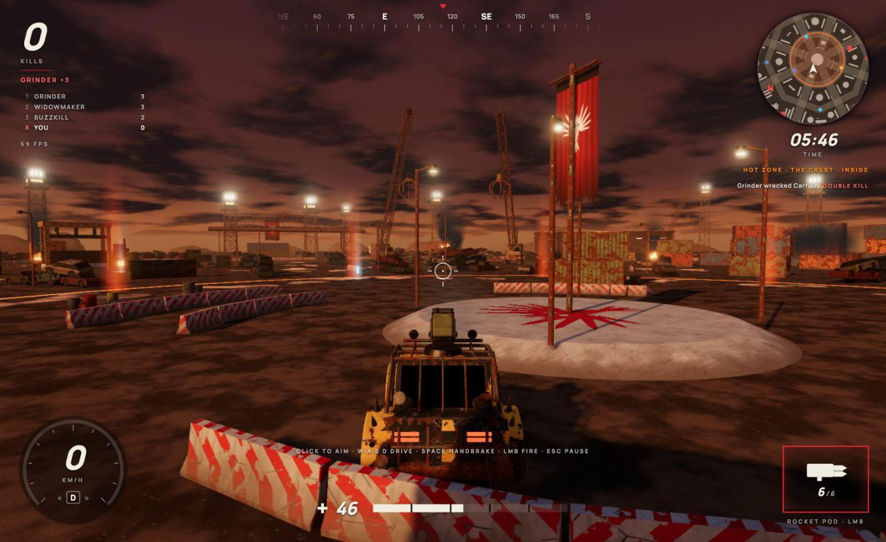
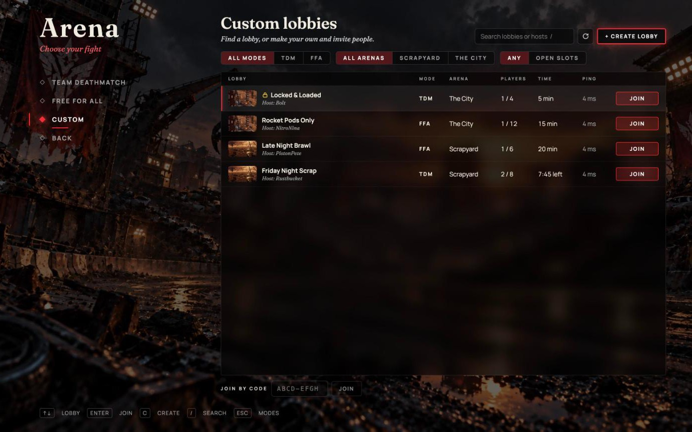
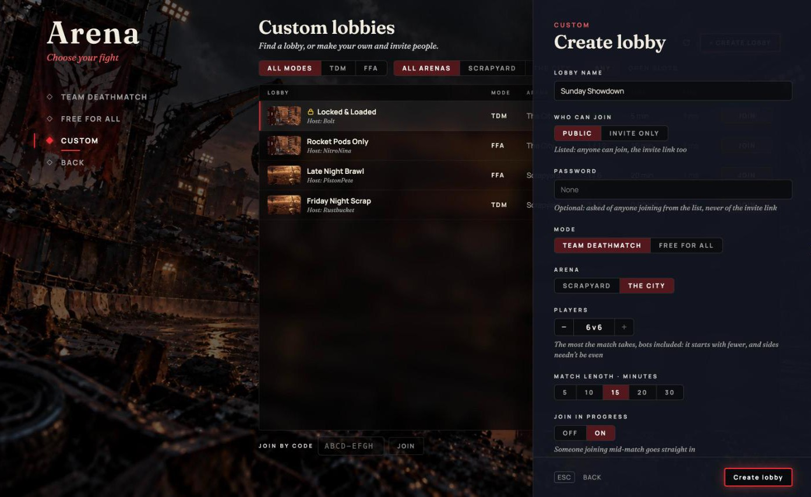
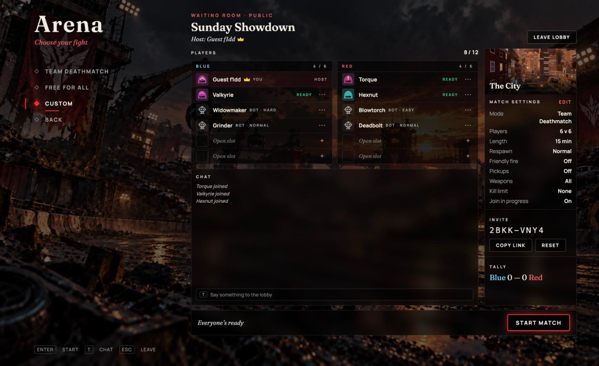
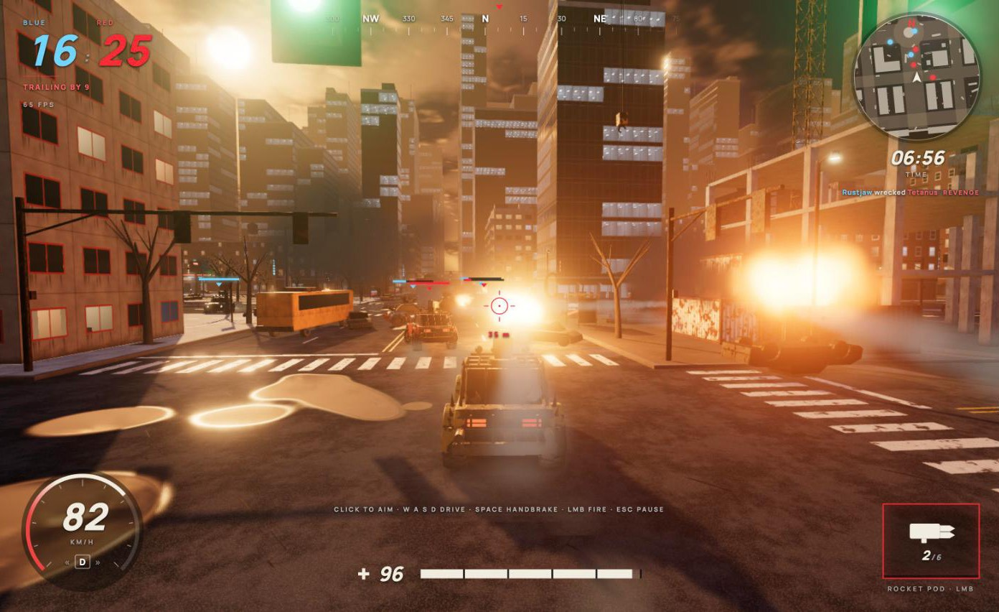
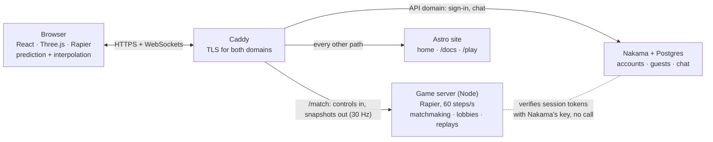

# BBMVC — Browser-based Multiplayer Vehicle Combat

The game is called **Scrapyard**: multiplayer car combat in the browser. Pick an armoured machine, bolt a gun to its roof, and fight across arenas built for wrecking each other — against bots in practice, against players through matchmaking, or in your own custom lobby with friends you invite. No install, no plugin: open the page and drive.

Scrapyard is in active development: new arenas, machines, and weapons land with each version.

[](.github/workflows/ci.yml)
[](https://www.typescriptlang.org/)
[](https://react.dev/)
[](https://threejs.org/)
[](https://rapier.rs/)
[](https://heroiclabs.com/nakama/)
[](https://astro.build/)
[](LICENSE)

<p align="center">
  
</p>

---

## The Game

What's in it today. The roster grows with each version; the game's patch notes and the guide always have the current list.

- **Modes.**
  - **Team Deathmatch:** Blue against Red, every wreck scores for the team, a tie goes to overtime and the next kill wins, with an MVP on the results screen.
  - **Free for All:** Eight machines, no allies, pickups dropping in waves from the two-minute mark (health, repair, ammo, speed, armour, damage boost) and a hot zone that moves around the arena.
- **Arenas.**
  - **The Scrapyard:** A walled octagon with the Crest at its heart, eight themed yards, and crew bases at its gates.
  - **The City:** A downtown street grid with themed blocks and a skyline.
  - **The Docks:** A container terminal at dusk: lanes between blocks of stacked containers, ship-to-shore cranes over the quay, and crew bases inside its gates.
- **Machines.**
  - **Razor:** A balanced 4×4 war rig — 100 hull, 98 km/h, quick off the line.
  - **Brute:** A heavy armoured hauler — 135 hull, 2,200 kg, a dozer blade on the nose; slower and wider in the turns, but it takes a beating.
  - **Scout:** A light raider — 70 hull, 1,000 kg, 120 km/h and the tightest turns; the quickest off the line, but three rockets wreck it.
  - **Buggy:** A dune buggy — 85 hull, 1,100 kg, 110 km/h, big tyres on long-travel arms; it soaks up the rough ground and lands on its wheels.
  - **Rammer:** A battering ram — 120 hull, 1,800 kg, 95 km/h, a V-plough on the nose; a car it drives into takes 2.5 hull a m/s of closing speed.
- **Guns.** A turret-mounted **Minigun** (a 60-round belt), a **Rocket Pod** (six unguided rockets with a blast that shoves cars aside), a **Cannon** (one heavy round a second, four to a clip, out to 260 m), a **Shotgun** (eight pellets a shot, six shots a load, out to 45 m), a **Laser** (a beam that burns while it's on a target and overheats after four seconds), **Homing Missiles** (four a load; locked on a rival held under the crosshair, they turn after it) or **Mines** (three a load, dropped behind you; each blows under the first rival to come near), picked in the garage with the machine.
- **Respawns.** The wait grows as the match goes on, with a moment of protection after; stuck on a wreck pile, `R` puts you back on the road.
- **Bots (Easy, Normal, or Hard).** They lead moving targets, weave, take cover, and lie in wait; they lock on before they let missiles go, lay mines in your way and steer round yours, and charge you in a Rammer. In Team Deathmatch they play as a crew — helping a teammate under fire, flanking, and finishing the damaged.
- **Classic online.** Find Match on the mode and arena you pick: eight at once, four or more after 10 seconds, any two after 30, a ready check, and human players taking over bots' seats. The search keeps going through a reload or a dropped connection.
- **Custom lobbies.** Browse a list of public lobbies, or host your own — public with an optional password, or invite-only by code or link. The owner sets the match: 2 to 12 machines (1v1 to 6v6), 5 to 30 minutes, join in progress, respawn speed, friendly fire, pickups, one gun for everyone, a kill limit; adds bots only where they want them; starts once everyone is ready. After each match everyone returns to the waiting room with the tally counting the wins.
- **Chat.** Available in online matches (all, team, whispers) and in a custom lobby's waiting room, carrying on into its match. Typing never drives your car.
- **Fair play.** The game server decides every hit, wreck, and score; the browser only sends its controls. Every online match is recorded with signs of aim help for review, with a deterministic replay that runs the match again to the bit.
- **Accounts.** Play straight away as a guest, or make an account on the site to keep your name.

<table>
  <tr>
    <td></td>
    <td></td>
  </tr>
  <tr>
    <td></td>
    <td></td>
  </tr>
  <tr>
    <td></td>
    <td></td>
  </tr>
  <tr>
    <td></td>
    <td></td>
  </tr>
</table>

### Controls

| Drive | Fight | Match |
| :--- | :--- | :--- |
| `W` `S` accelerate, brake / reverse | Mouse aims the turret and camera | `Tab` scoreboard (hold) |
| `A` `D` steer | Left button fires | `Enter` chat all, `T` chat team |
| `Space` handbrake, `R` unstick | Click captures the mouse | `Esc` pause |

> The site's guide (`www/src/content/guide/`, served at `/docs`) has the full rules, keys, and numbers.

---

## Architecture

The game server owns the match; Nakama owns who the player is. The browser predicts its own car with the same simulation the server runs, so driving feels instant while the server stays the referee. As deployed (`deploy/`); locally the browser reaches each service on its own port.



### How It's Built

- **Game (`game/`):** React + Three.js + Rapier, TypeScript, Vite. The exact same simulation runs in the browser and on the authoritative game server (`game/server/`, Node + WebSocket): **60 steps a second** on both, **snapshots at 30 Hz**, client prediction and interpolation, with hitscan rewound to what the shooter saw. Custom lobbies and matchmaking live on the game server too.
- **Accounts (`nakama/`):** [Nakama](https://heroiclabs.com/nakama/) on Postgres, run with Podman — email accounts, guests, sessions, and match chat. Nakama never runs gameplay.
- **Site (`www/`):** Astro (static) — home page, the guide (`/docs`), log in / register / account; serves the built game at `/play`.
- **Server (`deploy/`):** Caddy, the game server, Nakama, and Postgres in one compose file.

What changed in each version is tracked in [`CHANGELOG.md`](CHANGELOG.md); what players see is in the game's patch notes (`game/src/screens/PatchNotesPanel.tsx`, on the main menu).

---

## Run It Locally

### Prerequisites
- **Node.js** `24+`
- **Podman** (with `podman compose`)

### Quick Start

```sh
(cd game && npm ci) && (cd www && npm ci)
cp game/.env.example game/.env.local
cp www/.env.example www/.env
scripts/run.sh
```

| Service | Local Port / Path | Description |
| :--- | :--- | :--- |
| **Game Dev Server** | `:3000` | Vite dev server for `game/` |
| **Authoritative Server** | `:7360` | Node + WebSocket physics/lobby server |
| **Astro Site** | `:8000` | Static portal, `/docs`, and `/play` |
| **Nakama** | Podman container | Accounts, sessions, and chat |

- The site serves the last game build at `/play`: run `scripts/build.sh` once to make one.
- `Ctrl-C` stops the three Node/Vite/Astro servers; `cd nakama && podman compose down` stops Nakama.
- The `.env.example` files point at the local Nakama with its default keys; those are fine locally and refused by the deploy.

---

## Checks & Testing

```sh
# Game: lint, format, typecheck + build, then Vitest (simulation, rules, bots, protocol, lobbies, a real server over sockets)
(cd game && npm run lint && npm run format:check && npm run build && npm test)

# Site: lint, typecheck, build
(cd www && npm run lint && npm run check && npm run build)

# Tailwind classes not in canonical form (must list none)
node scripts/tailwind-classes.mjs
```

CI (`.github/workflows/ci.yml`) runs the game and site checks on every pull request.

Smoke tests need the local stack running (`scripts/run.sh`):

| Script | Checks |
| :--- | :--- |
| `scripts/nakama-smoke.mjs` | Accounts and sessions on Nakama |
| `scripts/match-smoke.mjs` | A guest takes a seat on the game server, on every arena |
| `scripts/chat-smoke.mjs` | The match chat's rules: rooms, limits, whispers |

---

## Deployment

### Self-Hosting

One compose stack, [`deploy/compose.yml`](deploy/compose.yml), on one server, run with Podman (`deploy.sh` and `backup.sh` call `podman compose`): **Caddy**, the **game server**, **Nakama** and its **Postgres**. Only Caddy publishes ports (`80` and `443`); the Nakama console listens on the server's loopback (`127.0.0.1:7351`; reach it over SSH). Caddy serves two names and gets their TLS certificates by itself once DNS points at the server; for a bare IP or a name without public DNS, add `tls internal` to each block of [`deploy/Caddyfile`](deploy/Caddyfile).

| Name | Path | Goes to |
| :--- | :--- | :--- |
| `SITE_DOMAIN` | every other path | The static site (`www/dist`), the game inside at `/play` |
| `SITE_DOMAIN` | `/match` | The game server (`game:7360`): online matches, over WebSocket |
| `SITE_DOMAIN` | `/api/stats` (GET) | Nakama's `get_stats` RPC (the player counts), with the HTTP key, which never leaves the server |
| `API_DOMAIN` | all | Nakama's HTTP API and realtime socket (`nakama:7350`): sign-in, sessions, chat |

Not in the repo: DNS, the server's size, its firewall, and the host's own Podman setup.

#### 1. Build

The game and the site take Nakama's public address and client key at build time, from `game/.env*` and `www/.env*` or the environment (see the `.env.example` files). As CI builds them, with your names:

```sh
export SITE_URL=https://example.com
export VITE_NAKAMA_HOST=api.example.com VITE_NAKAMA_PORT=443 VITE_NAKAMA_SSL=true VITE_NAKAMA_KEY=<NAKAMA_CLIENT_KEY>
export PUBLIC_NAKAMA_HOST=api.example.com PUBLIC_NAKAMA_PORT=443 PUBLIC_NAKAMA_SSL=true PUBLIC_NAKAMA_KEY=<NAKAMA_CLIENT_KEY>
(cd game && npm ci) && (cd www && npm ci)
scripts/build.sh
```

`scripts/build.sh` makes `www/dist` (the whole public site: static files with `.br` and `.gz` copies, the game at `/play`) and `game/dist-server` (the game server, run with plain `node`). The game finds the game server at `/match` on its own origin: no address to set.

#### 2. On the Server

Lay the files out as CI does, under `~/scrapyard/` (the compose file's paths are relative to `deploy/`):

| From the repo | To the server |
| :--- | :--- |
| `deploy/compose.yml`, `deploy/Caddyfile` | `~/scrapyard/deploy/` |
| `nakama/data/` | `~/scrapyard/nakama/data/` |
| `scripts/deploy.sh`, `scripts/backup.sh` | `~/scrapyard/scripts/` |
| what's in `www/dist/` | `~/scrapyard/site/incoming/` |
| what's in `game/dist-server/` (`load.js`, the capacity tool, isn't needed) | `~/scrapyard/server/incoming/` |

Then `~/scrapyard/deploy/.env`, from [`deploy/.env.example`](deploy/.env.example). It is never committed; generate each secret with `openssl rand -hex 24`. Compose refuses to start with any of these empty.

| Variable | What it is |
| :--- | :--- |
| `SITE_DOMAIN` | The site's name (`example.com`) |
| `API_DOMAIN` | Nakama's name (`api.example.com`) |
| `POSTGRES_PASSWORD` | Postgres' password |
| `NAKAMA_CLIENT_KEY` | Nakama's server key, which clients send: the value the build put into the game and the site, so not secret, but not Nakama's default |
| `NAKAMA_ENCRYPTION_KEY` | Signs sessions; the game server checks them with it |
| `NAKAMA_REFRESH_ENCRYPTION_KEY` | Signs refresh tokens (30 days); must differ from `NAKAMA_ENCRYPTION_KEY` |
| `NAKAMA_CONSOLE_USER`, `NAKAMA_CONSOLE_PASSWORD`, `NAKAMA_CONSOLE_SIGNING_KEY` | The Nakama console's login, and the key it signs with |
| `NAKAMA_HTTP_KEY` | Calls any RPC without a session; stays on the server (Caddy's `/api/stats`, `backup.sh`'s guest cleanup) |

**Keys.** None of these may keep Nakama's default. `scripts/deploy.sh` refuses to roll while `NAKAMA_ENCRYPTION_KEY` is unset or Nakama's default (`defaultencryptionkey`), or while `NAKAMA_REFRESH_ENCRYPTION_KEY` equals it: a 30-day refresh token would then pass for a session.

#### 3. Start and Update

As the user who owns `~/scrapyard` (CI's deploy runs the stack as that user, with rootless Podman), with a name for the release (CI names them by commit):

```sh
~/scrapyard/scripts/deploy.sh <release> --all
```

`deploy.sh` keeps `site/incoming` and `server/incoming` as that release (hard-linked snapshots in `site/releases/` and `server/releases/`), points `site/current` (what Caddy serves) at it, switches the game server to it on the first deploy and whenever its bundle differs from the one running (live online matches drop), starts what's stopped, and keeps the five newest releases.

| Flag | When |
| :--- | :--- |
| `--all` | The first deploy, and whenever `deploy/compose.yml` or `deploy/Caddyfile` changed: every service is recreated |
| `--nakama` | `nakama/data` changed: Nakama restarts and re-reads it (live matches drop) |
| `--server` | The game server switches to this release and restarts, even with the same bundle |

- **Update:** upload the new build to the two `incoming/` folders, then `scripts/deploy.sh <new release>`, with a flag if one applies.
- **Roll back:** `scripts/deploy.sh <earlier release>` (`ls ~/scrapyard/site/releases`); the game server goes back with it when that release's bundle differs.
- **Look:** `podman compose ps` and `podman compose logs` in `~/scrapyard/deploy`.
- **Check from outside**, as CI does: `NAKAMA_URL=https://api.example.com NAKAMA_CLIENT_KEY=<key> node scripts/nakama-smoke.mjs`, the same for `scripts/chat-smoke.mjs`, and with `SITE_URL=https://example.com` added for `scripts/match-smoke.mjs`.

#### 4. Backups

[`scripts/backup.sh`](scripts/backup.sh), nightly, from the server's crontab:

```sh
0 3 * * * ~/scrapyard/scripts/backup.sh
```

It dumps Nakama's database and archives the game server's match records (not the replays, which last 3 days) into `~/scrapyard/backups/`, keeping the newest 14 of each, then deletes the guests older than 3 days. Its header has the restore commands. Upgrading Nakama's image runs its migrations, which don't go back down: back up first.

### Our CI Deploy

The maintainers' setup: [`.github/workflows/deploy.yml`](.github/workflows/deploy.yml) builds, uploads and rolls our staging server after CI passes on a push to `main`, then smoke-tests it from outside, with no stored credentials (**GitHub OIDC → GCP Workload Identity Federation → OS Login over IAP**). Its header lists the repository variables and secrets it needs. In a fork with Actions on, a push to its `main` runs it too, and it fails without them: delete or disable it unless you copy that setup.

---

## Security

Found a vulnerability? See [`SECURITY.md`](SECURITY.md) — please don't open a public issue.

---

## License

MIT — see [`LICENSE`](LICENSE).
